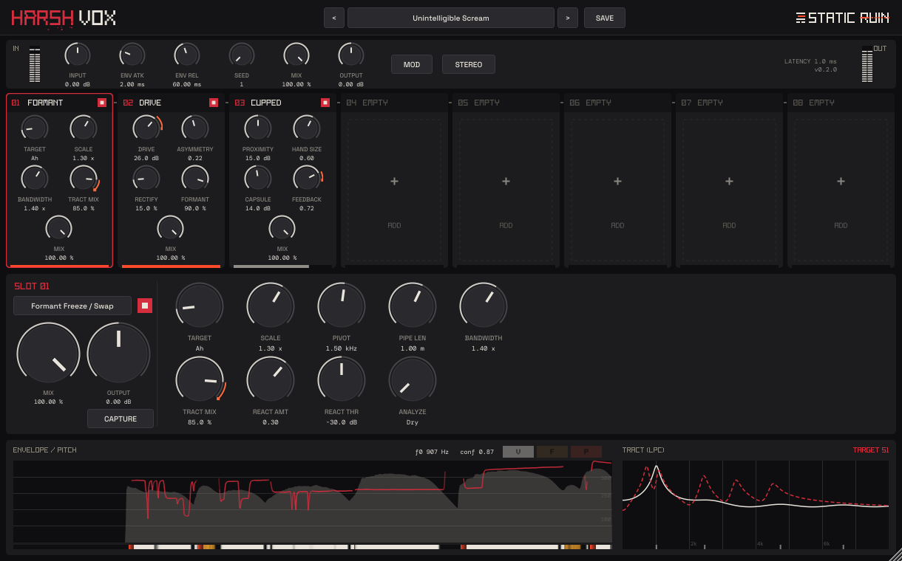

# Harsh Vox — Static Ruin

Vocal destruction multi-effect for noise, harsh noise and industrial music. Thirteen modules turn a voice
harsh, broken and unintelligible while it still reads as a human throat. Most of the damage is modelled
physically: excitation distortion, glottal-pulse manipulation, cupped and contact mics, collision rattles,
membranes. Little of it is plain clipping.



- **Format:** VST3 (JUCE 8.0.9, C++20, CMake). Mono or stereo in → stereo out, 44.1–192 kHz.
- **Chain:** 8 drag-to-reorder slots (any module, duplicates allowed) + 6 splitter send slots.
- **Static by design:** no LFOs, drift or accumulating state. Everything is input-reactive or seeded-deterministic,
  so the same input and settings give bit-identical output (covered by tests).

## Modules

| # | Module | What it does |
|---|--------|--------------|
| 4.1 | **Source Drive** | LPC inverse filter → asymmetric `tanh` on the *excitation* (+ rectifier blend) → original tract re-applied, auto level-compensated |
| 4.2 | **Period Doubler** | Every 2nd/3rd glottal period attenuated + time-skewed (PSOLA OLA on epochs), pulse-synchronous band-passed noise; zero-crossing cycle gating fallback |
| 4.3 | **Fry Gate** | Jittered 20–90 Hz pulse train (or f0/N) gating the voice; quieter input → slower, creakier |
| 4.4 | **Formant Freeze / Swap** | Excitation through a target tract: Capture snapshot, Ah/Uh/Ee/Oh, Mirror (log-reflected around a pivot), Scale, Pipe (closed-tube waveguide) |
| 4.5 | **Consonant / Vowel Splitter** | Voiced / fricative / plosive paths with 4 ms crossfades; comb on fricatives, noise-burst exciter on plosives; each path can feed a 2-module sub-chain |
| 4.6 | **Syllable Reverse / Shuffle** | Onset-segmented lookahead buffer; segments reversed in place or seeded-shuffled within the window |
| 4.7 | **Cupped Mic** | Proximity shelf, hand-cavity resonances, 20–30 dB high cut, capsule saturation, limited feedback loop through the same resonances |
| 4.8 | **Contact / Throat Mic** | Tissue compression, 24 dB/oct LPF, bone resonances, full-depth de-esser, seeded "flesh" impulse response |
| 4.9 | **Modal Rattle** | 20–60 two-pole modes (plate / Bessel drum / odd-harmonic pipe) or dispersive spring loop, with collision non-linearity and contact clicks, stereo modes |
| 4.10 | **Membrane Buzz** | Voice-driven membrane resonator slapping a one-sided stop → band-passed buzz (kazoo / mirliton) |
| 4.11 | **Organic Carrier Vocoder** | Poisson stream of damped-sinusoid pings (Crackle / Gravel / Sizzle / Wet) shaped by the LPC tract or a 32-band filterbank; optional pitch lock |
| 4.12 | **Saliva Clicks** | Envelope- and fricative-driven micro noise bursts filtered through the live tract |
| 4.13 | **Mob** | 4–16 seeded PSOLA copies (delay, pitch, formant scale, pan, ±15-cent micro-jitter), each gated at its own threshold |

**Factory presets:** Init, Unintelligible Scream, Inhuman Growl, Industrial Hiss, Speaking Gravel, Riot, Gagged,
Drainpipe, Feedback Throat, plus Oil Drum Sermon, Swallowed Tongue, Shuffled Tongues, Crackling Throat Fire and
Lo-Fi Fizz Mouth.

## Architecture

```
src/dsp/        headless DSP — depends only on juce::AudioBuffer (juce_audio_basics)
  Common.h        smoothers, biquads, delay lines, PCG32 PRNG, envelope follower
  Lpc.*           Levinson-Durbin, lattice analysis/synthesis, streaming LPC analyzer
  Yin.h           YIN on a decimated (~11 kHz) stream
  Analysis.*      shared analysis engine + history rings + AnalysisFrame
  ModuleInfo.h    module catalogue: parameter specs, mapping, formatting
  VocalModule.h   the module interface (spec §5) + ModuleBase helpers
  modules/        the 13 modules
  Engine.*        slots, splitter sends, modulation, latency, global section, limiter
  Params.h        parameter layout shared by plugin and tests
src/plugin/     AudioProcessor (APVTS, state, presets, slot reorder)
src/gui/        editor, block-letter font + logos, widgets, analysis display
tests/          Catch2 tests + signal generators / synthetic voice
tools/          hv_cli (render / bench / levels / gen-vocals), hv_ui_snapshot
```

- **Real-time safety.** Every slot pre-allocates *every* module type, so changing a module or reordering
  slots never allocates on the audio thread. There are no locks, file I/O or logging in `processBlock`;
  parameters arrive as APVTS atomics.
- **Analysis tap.** Analysis runs once per 64-sample sub-block on the dry (mono-summed) input and is kept
  in ~1.2 s history rings. Each slot receives an `AnalysisFrame` delayed by the latency upstream of it, so
  LPC, pitch and epochs stay aligned with the audio that slot actually hears. Source Drive and Formant
  Freeze also offer **Analyze: Local**, which runs their own LPC on their input.
- **Parameters.** Each slot has Type, On, Mix, Output and 12 generic parameters. Their host-visible names
  and value text follow the module in the slot ("S1 Drive"), and the host is notified when a slot changes
  module.
- **Latency.** Reported latency is the sum of enabled lookahead modules, plus the longest splitter send
  path, plus 1 ms of limiter lookahead. It is recomputed whenever a module or window changes. Slot and
  global dry paths are delay-compensated.

## Download (Windows VST3)

Every push to `main` builds the Windows x64 VST3 with GitHub Actions (`.github/workflows/build-windows.yml`) and
runs the unit tests on Windows. Grab **HarshVox-windows-x64-vst3** from the latest run's *Artifacts* on the
[Actions page](https://github.com/clhaydel/vocalVST/actions). Pushing a `v*` tag also attaches the zip to a
GitHub Release. Unzip it and copy `Harsh Vox.vst3` to `C:\Program Files\Common Files\VST3\`.

## Build (development)

Linux needs the usual JUCE dev packages (`libfreetype-dev libfontconfig-dev libx11-dev libxrandr-dev
libxinerama-dev libxcursor-dev libxext-dev libasound2-dev`), CMake ≥ 3.22 and Ninja.

```bash
git clone --recursive git@github.com:clhaydel/vocalVST.git && cd vocalVST
scripts/build.sh                                  # plugin, tests, tools (Release)
build/hv_tests_artefacts/Release/hv_tests         # unit tests
scripts/render_presets.sh                         # every preset x test_vocals/*.wav -> renders/ (+ spectrograms)
build/hv_cli_artefacts/Release/hv_cli bench       # per-module CPU @ 48 kHz / 128
scripts/run_pluginval.sh                          # pluginval, strictness 8
```

The VST3 lands in `build/HarshVox_artefacts/Release/VST3/Harsh Vox.vst3`; copy it to `~/.vst3/`.
User presets are saved as `.hvx` files under `~/.config/Static Ruin/Harsh Vox/Presets` on Linux
(`%APPDATA%\Static Ruin\Harsh Vox\Presets` on Windows).

**Turning your settings into factory presets:** preset menu → *Export preset as code*. This copies a ready-to-paste
`kFactory` entry for `src/plugin/Presets.cpp` to the clipboard and saves it to `Presets/Exports/<name>.txt`.
`hv_cli export-code <file.hvx> [name]` does the same for a saved `.hvx`.

## Verification status

- **Unit tests: 20 cases, 748 assertions, all passing.**
  - silence in → silence out for every module
  - no NaN/Inf on white noise, full-scale squares, DC and impulses at extreme settings
  - bit-identical determinism for modules and for every preset
  - reported latency = measured impulse delay for every module, multi-module chains and splitter sends
  - key frequencies within 2% at 44.1/48/96/192 kHz
  - YIN accuracy, LPC stability (|k| < 1) and exact lattice reconstruction
  - epoch spacing, classifier and onsets
  - limiter ceiling, state round-trip (including captured formants), drag-reorder and modulation
- **pluginval:** strictness 8, SUCCESS.
- **CPU** (Intel N100, 48 kHz / 128): analysis + global 3.5%, single modules +0.1 to +1.5% each,
  every module active (8 slots + sends) ≈ 11% of one core.

## Design notes and deviations

- **Formant targets** use a *parallel* formant band-pass bank in the pre-emphasised domain. A Klatt cascade
  driven by the whitened excitation came out far darker than the live voice. **Pipe** is a closed-tube
  waveguide (inverted feedback, wall loss) instead of 5 resonators, so a 2 m pipe gets its full
  odd-harmonic series rather than five modes below 400 Hz.
- **Cupped Mic.** The feedback loop is normalised by the capsule's small-signal gain, so loop gain equals
  the Feedback control. It rings hard toward howl (Feedback plus React reaches 0.995) but never
  self-sustains from silence.
- **Period Doubler** has a fixed 30 ms lookahead. Timing skew scales with Depth, so Depth 0 is fully
  transparent.
- **Syllable Reverse/Shuffle** reports window + 12 ms (onset-detection delay) + 64 samples of latency.
- **Mob.** PSOLA grain half-width is capped at 8 ms so the 30 ms minimum delay always has recorded material.
- **Stereo input** is summed to mono for the whole chain, not only for analysis. Mob and Modal Rattle create
  the stereo image, and modules after them process both channels independently.
- **Splitter sends** belong to the first active splitter in the chain. Splitters nested in sends are not
  offered.
- **Test vocals.** `test_vocals/` holds synthetic spoken/sung/screamed/whispered takes plus CMU ARCTIC read
  speech (free licence, see `test_vocals/CMU_ARCTIC_COPYING.txt`). Add real screamed takes for meaningful
  listening tests.

## Fonts

Headings and logos use a procedural block font (`src/gui/BlockFont.cpp`) in the Static Ruin house style.
UI text uses Space Grotesk and DM Mono, both SIL OFL 1.1 (`resources/fonts/`).
